# Независимое архитектурное и кодовое ревью WarsBots

**Дата ревью:** 30.10.2026  
**Статус прогона:** Read-only аудит кода, данных навигации и записанных сессионных логов (без запуска игры, сервера, сборок или модификации файлов).

---

## 0. Карта проверенных источников и версий (Source & Version Map)

| Роль / Назначение | Ветка / PR | Точный SHA | Локальный путь (проверено) | Статус |
| :--- | :--- | :--- | :--- | :--- |
| **Текущий рабочий кандидат (Shore C154)** | `codex/shore-ladder-exit` (Draft PR #2) | `ed72987c0c9fecb0c14e1cafdd3cc4162e7a13dd` | [r4-weapon-search-episode](file:///E:/WarsBots/Development/r4-weapon-search-episode) | Основной срез кода C++ для аудита (`Code/CryGame/Bots/*`, `Player.cpp`, `PlayerMovement.cpp`) |
| **Кандидат R4 Weapon Seek (C157)** | `codex/r4-weapon-search-episode` (Draft PR #1) | `cde778234a1db64fa7bfdf514a6d8e30d5697a63` | [C157-Steelmill-cde77823](file:///E:/WarsBots/Development/C157-Steelmill-cde77823) | Срез с эпизодическим поиском оружия (`BotWeaponSearchEpisode`) |
| **Канонический базовый код до PR** | `origin/warsbots/feature/claude-sprint` | `307037bc08050d39f26310dc6cc7071dddddf4a6` | [ds076-code](file:///C:/Users/Magic8/WarsBotsBuild/crymp-multibot/build/ds076-code) | Базовый срез геймплейного кода |
| **Витринный билд Steelmill Classic** | Showcase `abac72a9` | `abac72a9` | [Steelmill-Classic-abac72a9](file:///E:/WarsBots/Showcases/Steelmill-Classic-abac72a9) | Содержит [preset.json](file:///E:/WarsBots/Showcases/Steelmill-Classic-abac72a9/preset.json), [Steelmill.spots.txt](file:///E:/WarsBots/Showcases/Steelmill-Classic-abac72a9/Data/Steelmill.spots.txt), [Steelmill.links.txt](file:///E:/WarsBots/Showcases/Steelmill-Classic-abac72a9/Data/Steelmill.links.txt) и логи сессий `C155` |
| **Визуальные профили Shore (V1 / V2)** | `codex/shore-ladder-exit` | `ed72987c` | [Shore-ed72987c-v2](file:///E:/WarsBots/Visual/Shore-ed72987c-v2) | Логи сессий `C154-VisualV2` |
| **Документация и триаж** | `warsbots/research/steelmill-triage` | актуальный | [ds076-triage](file:///C:/Users/Magic8/WarsBotsBuild/crymp-multibot/build/ds076-triage) | [GEMINI_INITIAL_REVIEW.md](file:///C:/Users/Magic8/WarsBotsBuild/crymp-multibot/build/ds076-triage/Docs/Research/GEMINI_INITIAL_REVIEW.md), [STATUS.md](file:///C:/Users/Magic8/WarsBotsBuild/crymp-multibot/build/ds076-triage/Docs/Research/STATUS.md), [CS_BOT_MATURITY_PLAN.md](file:///C:/Users/Magic8/WarsBotsBuild/crymp-multibot/build/ds076-triage/Docs/Research/CS_BOT_MATURITY_PLAN.md) |
| **Реестр веток и аудит восстановления** | Audit 2026-10-30 | — | [branches.json](file:///E:/WarsBots/Repository-Audit-2026-10-30/branches.json), [recovery-audit.json](file:///E:/WarsBots/Recovery-2026-10-30/recovery-audit.json) | Полная опись веток и архивов |

---

## 1. Краткий вердикт: подходит ли текущая архитектура?

> [!IMPORTANT]
> **Главный вывод:** Отдельные изолированные C++-модули (`BotGoalArbiter`, `BotNavMeshCore`, `BotVantage`, `BotJumpLink`, `BotLadder`, `BotSuitPolicy`, `BotTrapWatchdog`) спроектированы качественно — они чистые (header-only / engine-free), детерминированные и покрыты быстрыми офлайн-тестами. Однако **способ их склейки внутри монолитного [`BotBrain::Update`](file:///E:/WarsBots/Development/r4-weapon-search-episode/Code/CryGame/Bots/BotBrain.cpp#L353-L526) (2069 строк) и размазанный контракт исполнения переходов между `BotBrain`, `BotLocomotion`, `BotMovement` и `CPlayer` в текущем виде НЕ позволяют устойчиво масштабировать поведение ботов.**

### Почему система ломается при каждом новом сценарии:
1. **Отсутствие единого владельца текущей задачи (Task / Sub-goal Ownership):** Внутри одного макро-состояния `BotState::SEARCHING_ENEMY` за одну и ту же переменную `m_patrolGoal` и один и тот же `BotIntent` конкурируют сразу 6 подсистем (`UpdateVantage`, `Heard gunshot`, `UpdateHotspot`, `RouteObjectives`, `UpdateRoam`, `BotDecisionCommit`). Они перезаписывают `m_patrolGoal` друг поверх друга **в рамках одного и того же тика**.
2. **Конфликт старого и нового пайплайнов принятия решений:** Новый [`BotGoalArbiter`](file:///E:/WarsBots/Development/r4-weapon-search-episode/Code/CryGame/Bots/BotGoalArbiter.h#L56-L157) (utility + гистерезис) вызывается из [`BotBrain::UpdateArbitrated`](file:///E:/WarsBots/Development/r4-weapon-search-episode/Code/CryGame/Bots/BotBrain.cpp#L1953-L2000), но перед ним, внутри него и после него остались старые императивные перехваты (`ShouldSeekFirstPrimary`, `if (enemy) UpdateCombat`, `m_stateCommit`, `m_moveCommit`), которые обходят решение арбитра.
3. **Связанность фича-флагов (`BotConfig` / `preset.json`):** Критические подсистемы связаны неявными цепочками (`wb_bot_vantage` управляет `PickupRange()`, который управляет `sniperMind`, который управляет вертикальным окном поиска оружия, радиусом поиска, оценкой ценности DSG1 и разрешением искать апгрейд после получения первого автомата). Выключение одного флага в пресете обрушивает 5 смежных механик.
4. **Несимметричный контракт специальных переходов (Links / Ladders / Jumps):** Планировщик пути (`NavMeshCore`) не знает об ограничениях исполнителя (`BotJumpLink::m_p.maxStrengthRise = 3.72f`), а исполнитель движения (`BotMovement::Move`) получает булев флаг `jumpTraverse = (jump || m_pending || m_airborne)` без привязки к вектору прыжка.

**Рекомендация:** Не делать полную переписку с нуля (Вариант 3) и не оставаться на точечных заплатках (Вариант 1). Нужен **Вариант 2 — Целевой структурный рефакторинг (Explicit Two-Layer Goal/Task + Transition Controller)** поверх уже написанных чистых модулей.

---

## 2. Реальная карта принятия решений и исполнения (End-to-End Pipeline)

```mermaid
flowchart TD
    subgraph Sense["1. Восприятие и Память (Sense & Memory)"]
        BB["BotBlackboard::Build\n(здоровье, энергия, скорость, grounded, water)"]
        FE["BotCombat::FindEnemy (каждые 0.6с)\nBotPerception (угол обзора, плащ, звук выстрела)\nПамять: m_target + m_lastSeen (до 3с/8с)"]
        TRAP["BotTrapWatchdog / BotStuck / m_blockedSeconds"]
    end

    subgraph Decide["2. Выбор макро-цели (Goal Selection)"]
        FP["Перехват 1: ShouldSeekFirstPrimary\n(обходит Arbiter, если нет primary и враг > 10м)"]
        ARB["BotGoalArbiter::Evaluate (wb_bot_arbiter=1)\nFight / Hunt / Weapon / Objective / Retreat / Roam"]
        FALL["Фолбэк в UpdateArbitrated (строка 1997):\nif (enemy) -> принудительно UpdateCombat!"]
        COMMIT["BotDecisionCommit (wb_bot_state_commit)\nЗащелка макро-состояния BotState (1.2с)"]
    end

    subgraph SubGoal["3. Внутренние под-цели Roam (Конфликт писателей!)"]
        VAN["UpdateVantage (wb_bot_vantage / wb_bot_high_ground)\nПишет m_patrolGoal = spot (каждый тик в Travel!)"]
        HEARD["UpdateRoam: Heard(4.0s)\nПЕРЕЗАПИСЫВАЕТ m_patrolGoal = heard\nна 30 строк ниже в ТОМ ЖЕ тике!"]
        HOT["UpdateHotspot / RouteObjectives / Nav::PickPatrolPoint"]
    end

    subgraph Nav["4. Маршрутизация (Pathfinding & Corners)"]
        STEER["BotBrain::Steer(from, goal)"]
        DETOUR["NavMeshCore::FindPathLinks (Detour A*, 16384 узлов)\n+ m_corners (BotCorners: до 32 углов + off-mesh links)"]
        MEMNAV["Фолбэк: BotNav (граф памяти .mem) или прямая линия"]
    end

    subgraph Trans["5. Специальные переходы (Transitions)"]
        LAD["BotLadder (wb_bot_ladder=1)\nApproach -> Grab -> Climb -> TopExit\nCPlayer: PrepareWarsBotLadderGraph / ExitPhysics"]
        LNK["BotJumpLink (wb_bot_jump_links=1)\nApproach -> Prepare -> RunUp -> Act -> Air -> Done/Failed"]
    end

    subgraph Exec["6. Локомоция и Физика (Execution)"]
        MCOM["MoveCommit (1.5с защелка intent.destination!)"]
        SUIT["BotSuitPolicy -> BotSuit::Apply (2с кулдаун)"]
        LOCO["BotLocomotion::Execute -> jump / m_pending / m_airborne"]
        MOVE["BotMovement::Move\nSafeStep (2D ray/box) обходится при jumpTraverse=true!"]
    end

    BB --> FE --> TRAP --> FP
    FP -->|не сработал| ARB --> FALL --> COMMIT
    COMMIT -->|SEARCHING_ENEMY| VAN --> HEARD --> HOT --> STEER
    STEER --> DETOUR --> LAD & LNK
    DETOUR --> MCOM
    LAD & LNK --> MCOM --> SUIT --> LOCO --> MOVE
```



### Таблица владельцев состояния, таймаутов и путей отмены

| Этап / Подсистема | Где живёт (Файл : Функция) | Кто владеет состоянием | Таймауты и гистерезис | Кто и как может отменить / перебить |
| :--- | :--- | :--- | :--- | :--- |
| **Память о цели (`m_target`)** | [`BotCombat::FindEnemy`](file:///E:/WarsBots/Development/r4-weapon-search-episode/Code/CryGame/Bots/BotCombat.cpp#L137-L273) | `BotCombat` (`m_target`, `m_lastSeen`, `m_heardPos`, `m_heardAt`) | Кэш без скана `0.6с`; удержание `remembered` `3.0с` ([строка 159](file:///E:/WarsBots/Development/r4-weapon-search-episode/Code/CryGame/Bots/BotCombat.cpp#L159)); `Heard` активен `4.0с` ([`BotBrain.cpp:950`](file:///E:/WarsBots/Development/r4-weapon-search-episode/Code/CryGame/Bots/BotBrain.cpp#L950)) | Потеря LOS > 3с при отсутствии новых целей сбрасывает `m_target=0`. Но пока `FindEnemy` возвращает `old` (до 3с после потери видимости), `enemy != nullptr`. |
| **Выбор цели (`ArbiterGoal`)** | [`BotBrain::UpdateArbitrated`](file:///E:/WarsBots/Development/r4-weapon-search-episode/Code/CryGame/Bots/BotBrain.cpp#L1953-L2000), [`BotGoalArbiter::Evaluate`](file:///E:/WarsBots/Development/r4-weapon-search-episode/Code/CryGame/Bots/BotGoalArbiter.h#L56-L157) | `BotBrain::m_arbiter` | `holdSeconds = 1.5с`, `switchMargin = 0.12`, `memorySeconds = 8.0с` | **Обходится ДО вызова:** `ShouldSeekFirstPrimary` ([`BotBrain.cpp:439`](file:///E:/WarsBots/Development/r4-weapon-search-episode/Code/CryGame/Bots/BotBrain.cpp#L439)). **Перебивается ПОСЛЕ вызова:** строка 1997 `if (enemy) { UpdateCombat(...); return true; }` даже если арбитр выбрал `Roam` или `Objective`! |
| **Защелка состояния и точки (`Commit`)** | [`BotBrain::Update`](file:///E:/WarsBots/Development/r4-weapon-search-episode/Code/CryGame/Bots/BotBrain.cpp#L475-L497), [`BotBrain::ExecuteIntent`](file:///E:/WarsBots/Development/r4-weapon-search-episode/Code/CryGame/Bots/BotBrain.cpp#L1393-L1413), [`BotDecisionCommit.h`](file:///E:/WarsBots/Development/r4-weapon-search-episode/Code/CryGame/Bots/BotDecisionCommit.h#L16-L115) | `m_stateCommit` (`StateCommit`), `m_moveCommit` (`MoveCommit`) | `StateCommit`: `1.2с` (снимается при `wb_bot_state_commit=2` и `wb_bot_arbiter=1`). `MoveCommit`: `1.5с` или радиус `1.5м` (НЕ отключается при `stateCommit=2`!) | В `ExecuteIntent` ([`BotBrain.cpp:1395`](file:///E:/WarsBots/Development/r4-weapon-search-episode/Code/CryGame/Bots/BotBrain.cpp#L1395)) `m_moveCommit` замораживает `intent.destination` на `1.5с`, если `intent.state` остался `SEARCHING_ENEMY`, даже если внутри `SEARCHING_ENEMY` сменилась под-цель! |
| **Поход за оружием (`WeaponGoal`)** | [`BotBrain::UpdateUpgrade`](file:///E:/WarsBots/Development/r4-weapon-search-episode/Code/CryGame/Bots/BotBrain.cpp#L819-L881), [`BotWeaponGoal.h`](file:///E:/WarsBots/Development/r4-weapon-search-episode/Code/CryGame/Bots/BotWeaponGoal.h#L15-L120) | `BotBrain::m_weaponGoal` + `m_weaponPath` | `maxTotalSeconds`: `15с` (или `28с` при `pathProgress=1`); `maxNoProgressSeconds`: `8с` (или `20с` при `pathProgress=1`); `cooldownSeconds = 20с` | Любой видимый враг или урон (`damagedRecently`), либо недостижимость по `NavMeshCore::Reachable`, либо истечение `maxNoProgressSeconds` (считается по прямой 3D-дистанции при `wb_bot_path_progress=0`!). |
| **Снайперская точка / Высота (`Vantage`)** | [`BotBrain::UpdateVantage`](file:///E:/WarsBots/Development/r4-weapon-search-episode/Code/CryGame/Bots/BotBrain.cpp#L1066-L1119), [`BotVantage.h`](file:///E:/WarsBots/Development/r4-weapon-search-episode/Code/CryGame/Bots/BotVantage.h#L70-L195) | `BotBrain::m_vantage`, `m_highUntil`, `m_nextHighRoll` | `maxTravel = 40с`, `holdClean = 22с`, `holdMax = 55с`, `cooldown = 25с`; `high_ground` окно `70с` (бросок раз в `20с`) | В фазе `Travel` возвращает `false` ([`BotBrain.cpp:1095`](file:///E:/WarsBots/Development/r4-weapon-search-episode/Code/CryGame/Bots/BotBrain.cpp#L1095)) и **немедленно перебивается** блоком `Heard` в `UpdateRoam` ([`BotBrain.cpp:950-965`](file:///E:/WarsBots/Development/r4-weapon-search-episode/Code/CryGame/Bots/BotBrain.cpp#L950-L965))! |
| **Следование по углам и прыжковым линкам (`Corners` / `JumpLink`)** | [`BotBrain::Steer`](file:///E:/WarsBots/Development/r4-weapon-search-episode/Code/CryGame/Bots/BotBrain.cpp#L1562-L1694), [`BotBrain::StepLink`](file:///E:/WarsBots/Development/r4-weapon-search-episode/Code/CryGame/Bots/BotBrain.cpp#L1696-L1764), [`BotJumpLink.h`](file:///E:/WarsBots/Development/r4-weapon-search-episode/Code/CryGame/Bots/BotJumpLink.h#L61-L196) | `m_corners` (`BotCorners`), `m_link` (`BotJumpLink`), `m_linkRef` | Пересчет пути каждые `1.5с` или при смещении цели `>2м`; `LinkParams`: `prepareMax=6с`, `noTakeoff=3.5с`, `total=12с` | Если `Steer` не вызывается в тике (например, бот переключился на `UpdateCombat`), `m_link` остаётся висеть до `total=12с` или сбрасывается только при смене цели `m_corners`. При фейле `NoteLinkFail` банит полигон только после **2** фейлов (при `wb_bot_link_failfast=0`). |
| **Лестница (`BotLadder`)** | [`BotBrain::StepLadder`](file:///E:/WarsBots/Development/r4-weapon-search-episode/Code/CryGame/Bots/BotBrain.cpp#L1766-L1885), [`BotLadder.h`](file:///E:/WarsBots/Development/r4-weapon-search-episode/Code/CryGame/Bots/BotLadder.h#L49-L195), [`Player.cpp`](file:///E:/WarsBots/Development/r4-weapon-search-episode/Code/CryGame/Actors/Player/Player.cpp#L7465-L7620) | `m_ladder` (`BotLadder`) + поля `m_warsBotLadder*` в `CPlayer` | `approachMax=4с`, `grabMax=1.5с`, `climbMax=12с`, `noProgressMax=2с`, `exitMax=2.5с`, `cooldown=8с` | Прерывается при `underFire` (если ещё не `onLadder`), смерти/заморозке, отсутствии прогресса `z` за `2.0с` или таймауте `exitMax=2.5с` -> `RequestLeaveLadder` + `RestoreWarsBotLadderGraph`. |
| **Анти-спам застреваний (`TrapWatchdog` / `Stuck`)** | [`BotBrain::Update`](file:///E:/WarsBots/Development/r4-weapon-search-episode/Code/CryGame/Bots/BotBrain.cpp#L397-L429), [`BotTrapWatchdog.h`](file:///E:/WarsBots/Development/r4-weapon-search-episode/Code/CryGame/Bots/BotTrapWatchdog.h#L18-L90), [`BotMovement.cpp`](file:///E:/WarsBots/Development/r4-weapon-search-episode/Code/CryGame/Bots/BotMovement.cpp#L106-L189) | `m_trap` (`BotTrapWatchdog`), `m_locomotion`, `m_movement` | `BotMovement`: `0.8с` (шаг вбок), `2.2с` (разворот на 150°); `BotBrain`: `m_blockedSeconds > 1.5с`; `TrapWatchdog`: `18с` в радиусе `3.5м` | `TrapWatchdog` сбрасывает `m_corners.Clear()`, `m_link.Reset()`, `m_vantage.Reset()`, но **подавляется** (`inTransition = true`), пока активны `m_ladder.Active()` или `m_link.Active()`! |

---

## 3. Код-ревью: ранжированные проблемы (по критичности и уверенности)

Все ссылки ниже проверены по коммиту `ed72987c0c9fecb0c14e1cafdd3cc4162e7a13dd` ([r4-weapon-search-episode](file:///E:/WarsBots/Development/r4-weapon-search-episode)).

### [P0 / КРИТИЧНО, Уверенность: 100% — подтверждено кодом и логами C155]
#### Находка #1: `UpdateVantage` в фазе `Travel` каждую 0.1 с перезаписывается блоком `Heard gunshot` в том же самом тике `UpdateRoam`
* **Где:** [`BotBrain.cpp:945-965`](file:///E:/WarsBots/Development/r4-weapon-search-episode/Code/CryGame/Bots/BotBrain.cpp#L945-L965) и [`BotBrain.cpp:1090-1096`](file:///E:/WarsBots/Development/r4-weapon-search-episode/Code/CryGame/Bots/BotBrain.cpp#L1090-L1096).
* **Механизм:**
  1. В начале [`BotBrain::UpdateRoam`](file:///E:/WarsBots/Development/r4-weapon-search-episode/Code/CryGame/Bots/BotBrain.cpp#L945) вызывается `if (UpdateVantage(bot, actor, decisionTime)) return;` (строка 945).
  2. Когда бот выбирает снайперскую точку или позицию `high_ground`, [`BotBrain::UpdateVantage`](file:///E:/WarsBots/Development/r4-weapon-search-episode/Code/CryGame/Bots/BotBrain.cpp#L1086-L1096) получает `o.phase == VantagePhase::Travel`, проверяет `(m_patrolGoal - spot).GetLengthSquared() > 1.0f`, пишет в лог `VANTAGE travel to ...`, выставляет:
     ```cpp
     m_patrolGoal = Vec3(o.x, o.y, o.z);
     m_patrolUntil = m_now + 5.0f;
     m_detour = false;
     return false; // the normal roam path walks there
     ```
  3. Так как `UpdateVantage` вернул `false`, управление продолжает идти вниз по `UpdateRoam` и **через 4 строки** попадает в блок слуха ([`BotBrain.cpp:949-965`](file:///E:/WarsBots/Development/r4-weapon-search-episode/Code/CryGame/Bots/BotBrain.cpp#L949-L965)):
     ```cpp
     Vec3 heard(0,0,0);
     if (BotConfig::Get().botPerception == 1 && m_combat.Heard(m_now, 4.0f, heard))
     {
         const float d2 = (heard - feet).GetLengthSquared();
         if (d2 > 36.0f && d2 < 2500.0f && ReachableForBot(feet, heard))
         {
             m_patrolGoal = heard;
             m_patrolUntil = m_now + 8.0f;
     ```
  4. Любой выстрел на карте в радиусе 6..50 м в течение 4 секунд **в том же тике затирает `m_patrolGoal` координатами выстрела `heard`!** И уже внизу `UpdateRoam` ([строка 1039](file:///E:/WarsBots/Development/r4-weapon-search-episode/Code/CryGame/Bots/BotBrain.cpp#L1039)) `Steer(feet, m_patrolGoal)` ведёт бота к выстрелу `heard`, а не к точке `Vantage`!
  5. На следующем тике (через 0.12 с) `UpdateVantage` снова видит, что `m_patrolGoal != spot`, снова печатает `VANTAGE travel to ...`, снова ставит `m_patrolGoal = spot`, и через 30 строк `Heard` снова затирает его на `heard`!
* **Доказательство из логов Steelmill (`C155`):**
  * В сессии 1 (`C155-SteelmillClassic-20261029-192838.bots.log`): `HIGH GROUND start` сработал **63 раза**, `VANTAGE travel` напечатался **996 раз** (каждые 0.12 с парой `VANTAGE travel` -> `HEARD gunshot`), а `VANTAGE hold` и `VANTAGE leave` равны **0**!
  * В сессии 2 (`C155-SteelmillClassic-20261029-195133.bots.log`): `HIGH GROUND start` — **115 раз**, `VANTAGE travel` — **2338 раз**, `VANTAGE hold` — **0**, `VANTAGE leave` — **0**!
* **Как проверить:** Офлайн-тест или греп лога `Select-String "VANTAGE travel|HEARD gunshot"` (уже подтверждено выше).

---

### [P0 / КРИТИЧНО, Уверенность: 100% — подтверждено кодом и данными `Steelmill.links.txt`]
#### Находка #2: `NavMeshCore::LoadLinkKinds` включает в граф Detour 76 неисполнимых `strength`-линков на Steelmill (`dz > 3.72 м`), которые `BotJumpLink` гарантированно отвергает только после прихода бота к стене
* **Где:** [`BotNavMeshCore.cpp:276-323`](file:///E:/WarsBots/Development/r4-weapon-search-episode/Code/CryGame/Bots/BotNavMeshCore.cpp#L276-L323), [`BotJumpLink.h:58`](file:///E:/WarsBots/Development/r4-weapon-search-episode/Code/CryGame/Bots/BotJumpLink.h#L58), [`BotJumpLink.h:94`](file:///E:/WarsBots/Development/r4-weapon-search-episode/Code/CryGame/Bots/BotJumpLink.h#L94) и мёртвая функция [`MaxStrengthLinkRise()`](file:///E:/WarsBots/Development/r4-weapon-search-episode/Code/CryGame/Bots/BotSniperReach.h#L23-L26).
* **Механизм:**
  1. В [`BotSniperReach.h:23`](file:///E:/WarsBots/Development/r4-weapon-search-episode/Code/CryGame/Bots/BotSniperReach.h#L23) объявлена функция `MaxStrengthLinkRise() = 3.72f` с комментарием: *«Links above this are not executable and must be rejected, not retried»*. **Но эта функция нигде в кодовой базе не вызывается!**
  2. При загрузке карты [`NavMeshCore::LoadLinkKinds`](file:///E:/WarsBots/Development/r4-weapon-search-episode/Code/CryGame/Bots/BotNavMeshCore.cpp#L276-L323) читает `Steelmill.links.txt` и выставляет флаг `NavLinkFlag(NavLinkStrength)` **всем** 293 `strength`-линкам без проверки `b[2] - a[2] <= 3.72f`.
  3. Анализ файла [Steelmill.links.txt](file:///E:/WarsBots/Showcases/Steelmill-Classic-abac72a9/Data/Steelmill.links.txt) показал: из **293** `strength`-линков ровно **76 линков (26%) имеют подъём `dz > 3.72 м`** (вплоть до `4.80 м`)!
  4. В результате `NavMeshCore::BuildComponents()` считает верхние ярусы/крыши достижимыми через эти 76 невозможных прыжков, а Detour `FindPathLinks` строит через них маршруты.
  5. Бот бежит через карту к точке отрыва `a`, запускает `m_link.Start(...)`, и на первом же тике [`BotJumpLink::Step`](file:///E:/WarsBots/Development/r4-weapon-search-episode/Code/CryGame/Bots/BotJumpLink.h#L94) выдаёт `LinkFail::TooHigh` (`LINK failed kind=strength reason=too_high`).
  6. Так как по умолчанию `wb_bot_link_failfast = 0` ([`BotConfig.h:104`](file:///E:/WarsBots/Development/r4-weapon-search-episode/Code/CryGame/Bots/BotConfig.h#L104)), [`NoteLinkFail`](file:///E:/WarsBots/Development/r4-weapon-search-episode/Code/CryGame/Bots/BotBrain.cpp#L1495-L1501) требует **2 отказа** на каждый полигон линка, прежде чем вызвать `BanLink(ref)`. А поскольку вдоль кромки крыши/уступа в `Steelmill.links.txt` напечено по 5–10 параллельных `strength`-линков с шагом 2 метра, бот по очереди пытается прыгнуть в каждый из них по два раза!
* **Как проверить:** В [`NavMeshCore::LoadLinkKinds`](file:///E:/WarsBots/Development/r4-weapon-search-episode/Code/CryGame/Bots/BotNavMeshCore.cpp#L292) при `k == NavLinkStrength` и `(l.b[2] - l.a[2]) > MaxStrengthLinkRise()` выставлять `l.kind = -1` (flag `0x4000`). Это мгновенно исключит все 76 ложных рёбер до `BuildComponents()`.

---

### [P0 / КРИТИЧНО, Уверенность: 100% — подтверждено `preset.json` и `BotBrain.cpp`]
#### Находка #3: Скрытая сцепка флагов (`wb_bot_vantage=0`, `wb_bot_sniper_reach=0`, `wb_bot_path_progress=0`) полностью отключает снайперский майндсет, высотный поиск оружия и ценность DSG1
* **Где:** [`preset.json`](file:///E:/WarsBots/Showcases/Steelmill-Classic-abac72a9/preset.json#L1-L40), [`BotBrain.cpp:790-805`](file:///E:/WarsBots/Development/r4-weapon-search-episode/Code/CryGame/Bots/BotBrain.cpp#L790-L805), [`BotBrain.cpp:834-860`](file:///E:/WarsBots/Development/r4-weapon-search-episode/Code/CryGame/Bots/BotBrain.cpp#L834-L860), [`BotWeapons.cpp:52-55`](file:///E:/WarsBots/Development/r4-weapon-search-episode/Code/CryGame/Bots/BotWeapons.cpp#L52-L55), [`BotUpgradeGate.h:18-24`](file:///E:/WarsBots/Development/r4-weapon-search-episode/Code/CryGame/Bots/BotUpgradeGate.h#L18-L24), [`BotWeaponRank.h:26-73`](file:///E:/WarsBots/Development/r4-weapon-search-episode/Code/CryGame/Bots/BotWeaponRank.h#L26-L73).
* **Механизм:**
  В витринном пресете Steelmill ([`preset.json`](file:///E:/WarsBots/Showcases/Steelmill-Classic-abac72a9/preset.json)) и дефолтах [`BotConfig.h`](file:///E:/WarsBots/Development/r4-weapon-search-episode/Code/CryGame/Bots/BotConfig.h#L80-L120) выставлено:
  * `"wb_bot_vantage": 0`
  * `"wb_bot_path_progress": 0`
  * `wb_bot_sniper_reach` отсутствует в пресете (дефолт `0`)
  * `"wb_bot_first_primary": 1`, `"wb_bot_high_ground": 1`
  
  Посмотрим, к какой цепной реакции в коде это приводит:
  1. [`BotBrain::PickupRange()`](file:///E:/WarsBots/Development/r4-weapon-search-episode/Code/CryGame/Bots/BotBrain.cpp#L790-L791) вычисляет:
     ```cpp
     return IdleHoldRange(BotConfig::Get().vantage == 1 && m_traits.camper >= 0.7f);
     ```
     Поскольку `vantage == 0`, `PickupRange()` **всегда возвращает `20.0f`** (никогда `60.0f`), даже для снайперов (`Marksman` с `camper = 0.9f`)!
  2. В [`BotBrain::UpgradeCandidate`](file:///E:/WarsBots/Development/r4-weapon-search-episode/Code/CryGame/Bots/BotBrain.cpp#L800-L804) и [`BotBrain::UpdateUpgrade`](file:///E:/WarsBots/Development/r4-weapon-search-episode/Code/CryGame/Bots/BotBrain.cpp#L834) `sniperMind = typical > 30.0f` становится **`false`**!
  3. Из-за `sniperMind == false`:
     * Как только бот подбирает любой первый автомат на земле (`SCAR`, `FY71`, `SMG`) через `wb_bot_first_primary=1`, функция [`ShouldSearchUpgrade(hasPrimary=true, ranked=true, sniperMind=false, ...)`](file:///E:/WarsBots/Development/r4-weapon-search-episode/Code/CryGame/Bots/BotUpgradeGate.h#L18-L24) возвращает **`false`**! Бот **навсегда прекращает искать оружие (включая DSG1 и Gauss)** до самой смерти!
     * Даже пока у бота только пистолет, на дистанции `typicalRange = 20.0f` функция [`FightValue("DSG1", 20.0f)`](file:///E:/WarsBots/Development/r4-weapon-search-episode/Code/CryGame/Bots/BotWeaponRank.h#L47-L60) оценивает DSG1 всего в **`0.75`**, тогда как `SCAR` оценивается в **`1.00`**, `FY71` — в **`0.95`**, `SMG` — в **`0.85`**. Любой автомат в радиусе 45 м выигрывает у DSG1 по utility!
     * Даже если `sniperMind` был бы `true`, при `wb_bot_sniper_reach = 0` в [`BotWeapons::FindNearby`](file:///E:/WarsBots/Development/r4-weapon-search-episode/Code/CryGame/Bots/BotWeapons.cpp#L53) `SniperSearchHalfHeight(false)` ограничивает вертикальный AABB поиска оружия `±12.0 м`, отсекая крыши выше 12 м.
     * Наконец, при `wb_bot_path_progress = 0` прогресс к оружию ([`BotBrain.cpp:857`](file:///E:/WarsBots/Development/r4-weapon-search-episode/Code/CryGame/Bots/BotBrain.cpp#L857)) замеряется по прямой 3D-евклидовой дистанции с таймаутом `8.0 с`, что сбрасывает обходные маршруты по лестничным пролётам.

---

### [P1 / ВЫСОКИЙ, Уверенность: 95% — подтверждено кодом]
#### Находка #4: `UpdateArbitrated` игнорирует решение `GoalArbiter::Roam` / `Objective`, если `m_combat.FindEnemy` вернул запомненного (невидимого) врага, и блокирует `UpdateVantage` в начале боя
* **Где:** [`BotBrain.cpp:1990-1999`](file:///E:/WarsBots/Development/r4-weapon-search-episode/Code/CryGame/Bots/BotBrain.cpp#L1990-L1999) и [`BotBrain.cpp:1070`](file:///E:/WarsBots/Development/r4-weapon-search-episode/Code/CryGame/Bots/BotBrain.cpp#L1070).
* **Механизм:**
  1. Посмотрим на концовку [`BotBrain::UpdateArbitrated`](file:///E:/WarsBots/Development/r4-weapon-search-episode/Code/CryGame/Bots/BotBrain.cpp#L1992-L1999):
     ```cpp
     if ((d.goal == ArbiterGoal::Fight || d.goal == ArbiterGoal::Hunt) && enemy) { UpdateCombat(bot, actor, decisionTime); return true; }
     if ((d.goal == ArbiterGoal::Retreat || d.goal == ArbiterGoal::Cover) && enemy) { UpdateCombat(bot, actor, decisionTime); return true; }
     if (d.goal == ArbiterGoal::Objective && RouteObjectives(bot.GetEntity()->GetWorldPos(), decisionTime)) return true;
     // Goal without an executable target this tick (item gone, target forgotten): the old order decides.
     if (enemy) { UpdateCombat(bot, actor, decisionTime); return true; }
     UpdateRoam(bot, actor, decisionTime);
     ```
     Если `GoalArbiter::Evaluate` выбрал `ArbiterGoal::Roam` (например, `HuntScore` стал ниже `RoamScore = 0.25f` для `Defender`/`Marksman`, когда враг далеко и скрыт за стеной: `HuntScore = 0.52 - 0.14*(d/80) - 0.28*(age/8)` опускается ниже `0.25` уже через ~4.5 с при `remembered`), строка 1997 видит `enemy != nullptr` и **принудительно вызывает `UpdateCombat` вместо `UpdateRoam`**!
  2. Более того, в [`BotBrain::UpdateVantage`](file:///E:/WarsBots/Development/r4-weapon-search-episode/Code/CryGame/Bots/BotBrain.cpp#L1070) первый бросок кубика на `high_ground` при спавне бота отложен на 20 секунд:
     ```cpp
     if (m_nextHighRoll <= 0.0f) m_nextHighRoll = m_now + 20.0f;
     ```
     На компактной карте вроде Steelmill за первые 20 секунд бот почти гарантированно вступает в контакт с противником или слышит выстрелы, из-за чего окно спокойного подъёма на крышу со спавна пропускается.

---

### [P1 / ВЫСОКИЙ, Уверенность: 95% — подтверждено кодом]
#### Находка #5: Разрыв контракта направления прыжка (R9) между `BotLocomotion::Execute` и `BotMovement::Move`
* **Где:** [`BotBrain.cpp:1464-1474`](file:///E:/WarsBots/Development/r4-weapon-search-episode/Code/CryGame/Bots/BotBrain.cpp#L1464-L1474), [`BotLocomotion.cpp:35-83`](file:///E:/WarsBots/Development/r4-weapon-search-episode/Code/CryGame/Bots/BotLocomotion.cpp#L35-L83), [`BotMovement.cpp:106-145`](file:///E:/WarsBots/Development/r4-weapon-search-episode/Code/CryGame/Bots/BotMovement.cpp#L106-L145).
* **Механизм:**
  1. В [`BotBrain::ExecuteIntent`](file:///E:/WarsBots/Development/r4-weapon-search-episode/Code/CryGame/Bots/BotBrain.cpp#L1466-L1468) вызываются подряд:
     ```cpp
     const bool jump = m_locomotion.Execute(actor, m_blackboard, intent, m_suit, m_now);
     m_movement.Move(actor, m_blackboard, intent, m_combat, m_suit, m_now, decisionTime,
         jump || m_locomotion.Pending() || m_locomotion.Airborne());
     ```
  2. Последний аргумент `jumpTraverse` в [`BotMovement::Move`](file:///E:/WarsBots/Development/r4-weapon-search-episode/Code/CryGame/Bots/BotMovement.cpp#L121) **отключает `SafeStep` (проверку препятствий перед ногами и обход углов)**:
     ```cpp
     const Vec3 desired = jumpTraverse ? toGoal.GetNormalizedSafe(FORWARD_DIRECTION) : SafeStep(actor, from, toGoal);
     ```
  3. Когда `BotLocomotion::Execute` запрашивает обычный прыжок (например, `intent.jump` из уклонения в бою, перепрыгивания преграды при застревании или прыжка на бегу), он взводит `m_pending = true` (до 0.25 с) и затем `m_airborne = true`, но **не сохраняет целевой вектор прыжка**, для которого была проверена безопасность!
  4. Если на следующем тике (пока `m_pending` или `m_airborne` ещё `true`) `intent.destination` меняется (например, из-за смены стрейфа в бою, `Heard` или отмены линка), `BotMovement::Move` всё ещё получает `jumpTraverse == true` и направляет бота напрямую в новую точку **вслепую (без `SafeStep`)**, впечатывая его в стены или сбрасывая с уступов.

---

### [P1 / ВЫСОКИЙ, Уверенность: 90% — подтверждено кодом]
#### Находка #6: `MoveCommit` в `ExecuteIntent` блокирует переключение между под-целями внутри одного `BotState::SEARCHING_ENEMY`
* **Где:** [`BotBrain.cpp:1393-1413`](file:///E:/WarsBots/Development/r4-weapon-search-episode/Code/CryGame/Bots/BotBrain.cpp#L1393-L1413) и [`BotDecisionCommit.h:68-114`](file:///E:/WarsBots/Development/r4-weapon-search-episode/Code/CryGame/Bots/BotDecisionCommit.h#L68-L114).
* **Механизм:**
  В [`BotBrain::Update`](file:///E:/WarsBots/Development/r4-weapon-search-episode/Code/CryGame/Bots/BotBrain.cpp#L477) для `m_stateCommit` сделана защита от двойного гистерезиса при включённом `GoalArbiter`: `const bool runStateCommit = sc == 1 || (sc == 2 && BotConfig::Get().arbiter != 1);`.
  Однако в [`BotBrain::ExecuteIntent`](file:///E:/WarsBots/Development/r4-weapon-search-episode/Code/CryGame/Bots/BotBrain.cpp#L1395) `m_moveCommit` вызывается при **любом** `wb_bot_state_commit != 0` (включая дефолтный `2`!). Поскольку и `Roam`, и `Vantage`, и `Weapon`, и `Objective`, и `Heard` используют одно и то же перечисление `intent.state == BotState::SEARCHING_ENEMY`, `m_moveCommit.Filter` считает, что состояние не менялось, и в течение `1.5 с` **отбрасывает новую точку `intent.destination`**, возвращая старый `m_goal` (если только бот уже не подошёл к старому `m_goal` ближе 1.5 м). Из-за этого на первых 1.5 с после смены цели в `Arbiter` или `Corners` бот физически шагает к предыдущему углу маршрута!

---

### [P2 / СРЕДНИЙ, Уверенность: 95% — подтверждено кодом]
#### Находка #7: Геометрические константы физического выхода с лестницы (`ProcessWarsBotLadderPhysicsExit`) жёстко подогнаны под лестницу Shore
* **Где:** [`PlayerMovement.cpp:1667-1778`](file:///E:/WarsBots/Development/r4-weapon-search-episode/Code/CryGame/Actors/Player/PlayerMovement.cpp#L1667-L1778) и [`Player.cpp:7477-7488`](file:///E:/WarsBots/Development/r4-weapon-search-episode/Code/CryGame/Actors/Player/Player.cpp#L7477-L7488).
* **Механизм:**
  Функция [`ProcessWarsBotLadderPhysicsExit`](file:///E:/WarsBots/Development/r4-weapon-search-episode/Code/CryGame/Actors/Player/PlayerMovement.cpp#L1667) содержит жёсткий фильтр:
  ```cpp
  if ((top - bottom).len2() < 16.0f || up.z < 0.85f) { player.RestoreWarsBotLadderGraph(); return false; }
  ```
  То есть любая лестница короче **4.0 метров** (`len2 < 16.0f`) или с площадкой выхода ближе `0.6 м` / дальше `2.0 м` от `ladderTop` ([`Player.cpp:7485`](file:///E:/WarsBots/Development/r4-weapon-search-episode/Code/CryGame/Actors/Player/Player.cpp#L7485)) на выделенном сервере (где у персонажа нет клипа `relaxed_ladderOffTop_nw_01`, `exitClip == -1`) **не получит физического доводчика выхода** и сбросит граф посередине `isExitingLadder`!

---

## 4. Глубокий разбор Кейса A: Почему боты не занимают крышу Steelmill?

Ниже приведена полная трассировка по всем 6 звеньям цепочки — от представления данных до удержания позиции.

### Диагностика по цепочке (6 звеньев)

| Звено цепочки | Что происходит в коде и данных сейчас | Статус звена |
| :--- | :--- | :--- |
| **1. Представление данных (`Steelmill.spots.txt`, `Steelmill.links.txt`)** | В [`Steelmill.spots.txt`](file:///E:/WarsBots/Showcases/Steelmill-Classic-abac72a9/Data/Steelmill.spots.txt) есть **256** снайперских точек (`flags & 4`), из которых **253 находятся на высоте `z > 142 м`** (включая верхние ярусы и крышу `z = 145..149.74 м` с отличным обзором `view = 140..180`). Точки загружаются корректно (`VANTAGE 256 sniper spots`). Однако в [`Steelmill.links.txt`](file:///E:/WarsBots/Showcases/Steelmill-Classic-abac72a9/Data/Steelmill.links.txt) **0 лестниц (`ladder`)**, а из **293** `strength`-линков **76 имеют `dz > 3.72 м`** (до `4.80 м`). | Данные точек **есть**; данные линковочных переходов **загрязнены 76 неисполнимыми `strength`-прыжками**. |
| **2. Eligibility & Utility (Вход в режим крыши / поиска винтовки)** | В [`preset.json`](file:///E:/WarsBots/Showcases/Steelmill-Classic-abac72a9/preset.json) стоит **`"wb_bot_vantage": 0`**, **`"wb_bot_path_progress": 0`**, а `wb_bot_sniper_reach` выключен (`0`). Из-за `vantage == 0`:<br>1) Чистый снайперский режим (где бот с `camper >= 0.7` и DSG1/Gauss идёт на крышу) **полностью выключен** ([`BotBrain.cpp:1068`](file:///E:/WarsBots/Development/r4-weapon-search-episode/Code/CryGame/Bots/BotBrain.cpp#L1068)).<br>2) `PickupRange()` всегда равен `20 м` -> `sniperMind == false` -> после подбора любого автомата на спавне (`first_primary=1`) бот **вообще не ищет DSG1**, а до подбора автомата оценивает DSG1 (`0.75`) ниже SCAR (`1.00`) и FY71 (`0.95`).<br>3) Единственный оставшийся вход в `UpdateVantage` — это `wb_bot_high_ground=1` (25% у Veteran, 45% у Elite раз в 20 с, начиная с `t = 20 с`). | **Блокиратор #1 (Конфиг и сцепка с `PickupRange`)**: 100% отключение снайперского пути и деградация подбора DSG1. |
| **3. Выбор точки (`VantageMap::Pick`)** | Когда `high_ground` всё же срабатывает (63 раза в сессии 1, 115 раз в сессии 2), [`VantageMap::Pick`](file:///E:/WarsBots/Development/r4-weapon-search-episode/Code/CryGame/Bots/BotVantage.h#L118-L143) выбирает точку по `score = view + 2.0f * (s.z - feet.z) - 0.35f * d` среди всех точек в радиусе `maxTravel = 90 м` по прямой, проверяя `ReachableForBot(feet, spot)`. | Точка на высоте (`z = 142..149 м`) **выбирается** (`VANTAGE travel to (1230.8, 1301.6, 142.0)`). |
| **4. Удержание цели в `UpdateRoam` (Конкуренция с `Heard` и `Arbiter`)** | Как только `UpdateVantage` ставит `m_patrolGoal = spot` и возвращает `false` (фаза `Travel`), **в том же тике через 30 строк** [`UpdateRoam`](file:///E:/WarsBots/Development/r4-weapon-search-episode/Code/CryGame/Bots/BotBrain.cpp#L950-L965) проверяет `m_combat.Heard(m_now, 4.0f, heard)` и **перезаписывает `m_patrolGoal = heard`**! А если бот увидел врага и потерял его из виду, `UpdateArbitrated` ([строка 1997](file:///E:/WarsBots/Development/r4-weapon-search-episode/Code/CryGame/Bots/BotBrain.cpp#L1997)) не пускает бота в `UpdateRoam`, пока `FindEnemy` возвращает `enemy`. | **Блокиратор #2 (Баг перезаписи в `UpdateRoam`)**: В логах C155 из **3334** тиков `VANTAGE travel` боты **0 раз** дошли до фазы `VANTAGE hold`! |
| **5. Маршрутизация и прохождение переходов (`NavMeshCore` + `BotJumpLink`)** | Даже когда выстрелов нет 4 секунды и бот начинает идти к точке крыши, `NavMeshCore::Reachable` и `FindPathLinks` используют все 293 `strength`-линка, включая **76 невозможных (`dz > 3.72 м`)**. В сессии 2 зафиксировано 67 обрывов линковых переходов (`LINK failed reason=too_high` и `reason=missed_landing`). | **Блокиратор #3 (Ложная достижимость в графе)**: Маршруты через `dz > 3.72 м` обрываются у стены. |
| **6. Удержание и использование позиции (`VantagePhase::Hold`)** | В фазе `Hold` ([`BotBrain.cpp:1097-1117`](file:///E:/WarsBots/Development/r4-weapon-search-episode/Code/CryGame/Bots/BotBrain.cpp#L1097-L1117)) бот останавливается, приседает/ложится и сканирует сектор `bestYaw ± 35°`. Но как только в секторе появляется враг, на следующем тике `enemy != nullptr`, `UpdateRoam` (и `UpdateVantage`) перестаёт вызываться, и управление забирает [`UpdateCombat`](file:///E:/WarsBots/Development/r4-weapon-search-episode/Code/CryGame/Bots/BotBrain.cpp#L562), который для обычного автомата (`desiredRange = 18..28 м`) приказывает боту **бежать вперёд к врагу (`Chase`) и спрыгивать с крыши**! | **Блокиратор #4 (Потеря позиции в бою)**: `UpdateCombat` не знает, что бот удерживает `Vantage` / `high_ground`, и стаскивает его вниз. |

### Ранжированные гипотезы по крыше Steelmill

1. **Гипотеза H1 (Вероятность 100%, подтверждена логами C155):** Боты в режиме `high_ground` **вообще не идут к выбранной высотной точке**, потому что в [`BotBrain::UpdateRoam`](file:///E:/WarsBots/Development/r4-weapon-search-episode/Code/CryGame/Bots/BotBrain.cpp#L945-L965) вызов `UpdateVantage` в фазе `VantagePhase::Travel` возвращает `false`, после чего блок `m_combat.Heard(m_now, 4.0f, heard)` в том же тике перезаписывает `m_patrolGoal = heard`. На карте с 8 ботами выстрелы в радиусе 50 м звучат почти непрерывно (`4778` записей `HEARD gunshot` за две сессии), поэтому `VANTAGE hold` равен **0 из 178 попыток**.
2. **Гипотеза H2 (Вероятность 100%, подтверждена `preset.json` и кодом):** В [`preset.json`](file:///E:/WarsBots/Showcases/Steelmill-Classic-abac72a9/preset.json) выключены `wb_bot_vantage=0`, `wb_bot_sniper_reach=0`, `wb_bot_path_progress=0`, что через `PickupRange() == 20.0f` блокирует поиск снайперских винтовок (`sniperMind = false`) и целевой снайперский подъём на крышу.
3. **Гипотеза H3 (Вероятность 95%, подтверждена `Steelmill.links.txt` и `BotNavMeshCore.cpp`):** Даже при немом тесте (без стрельбы) часть маршрутов на верхние отметки крыши (`z = 146..149.7 м`) строится через 76 неисполнимых `strength`-линков с `dz = 3.73..4.80 м`, так как `NavMeshCore::LoadLinkKinds` не фильтрует их по `MaxStrengthLinkRise() = 3.72f`.
4. **Гипотеза H4 (Вероятность 90%, подтверждена `BotBrain.cpp`):** Даже когда бот достигнет крыши, при первом же визуальном контакте с врагом `UpdateCombat` не учитывает активный `m_vantage` (`Hold`) и при оружии со средним `desiredRange` (SCAR/FY71) запускает `Chase`, уводя бота с крыши.

---

## 5. Глубокий разбор Кейса B: Почему исправление лестницы Shore потребовало 7+ итераций?

Эволюция фиксов C154 (`abac72a9` -> `307037bc` -> `8ed16c78`/`96e4a383` -> `0851e685` -> `63eef004` -> `d2dc767e` -> `ed72987c` + визуальные прогоны V1/V2) вскрыла сразу две группы причин: **архитектурно-движковую** и **процессно-инструментальную**.

### 5.1. Технические причины (Движок Crysis + Архитектура WarsBots)
В Crysis 2007 логика лестницы размазана по 4 слоям (`CPlayer::UpdateStats`, `CPlayerMovement`, `IAnimationGraphState` и физическая сущность `PE_LIVING`), которые ведут себя **принципиально по-разному для клиента с каналом и для серверного бота с `channelId == 0`**:

1. **Серверный бот не крутит анимационный граф по умолчанию (`AlwaysPhysics` vs `PerAnimGraph`):**
   * У обычного игрока верхний выход с лестницы (`LeaveLadder(eLAT_ExitTop)`) запускает анимацию `relaxed_ladderOffTop_nw_01`, движение которой (`eMCM_Animation`) переносит физическое тело вперёд на площадку, а по окончании клипа срабатывает выход графа `LeaveLadder`, сбрасывающий `isOnLadder = false`.
   * У серверного бота (`channelId == 0`) в `AnimatedCharacter` стоял режим `AlwaysPhysics` и боевая стойка `combat`, тогда как состояние верхнего выхода в графе наследует `RelaxedNW`. Первые итерации пытались починить вход/выход в `BotLadder.h`, не подозревая, что граф на сервере вообще не активирует переход.
2. **Окно гонки в 1 кадр при передаче управления графу (`PrePhysicsUpdate`):**
   * Когда `LeaveLadder(eLAT_ExitTop)` посылает одноразовый сигнал `Signal = exit_ladder_top`, флаг `m_stats.isExitingLadder` выставляется **после** того, как `PrePhysicsUpdate` уже вычислил `exiting = false` для текущего кадра. В результате `AnimatedCharacter` переключается в `PerAnimGraph` только на **следующем** кадре, когда одноразовый сигнал мог быть уже потерян (`TryWarsBotLadderExitRetry`).
3. **На выделенном сервере (`CryMP-Server64.exe`) у модели вообще нет клипа выхода (`exitClip = -1, FIFO0 = 0`):**
   * Только после добавления детальной телеметрии (`LADDER EXIT DIAG`) выяснилось, что на dedicated-сервере `GetAnimIDByName("relaxed_ladderOffTop_nw_01")` возвращает `-1`! Никакие манипуляции с `IAnimationGraphState` не могли сдвинуть бота, если анимационный ассет отсутствует в серверном наборе анимаций.
4. **Конфликт `k_ladderExitCollider` и гравитации на последнем шаге:**
   * Когда для `exitClip == -1` добавили физический доводчик [`ProcessWarsBotLadderPhysicsExit`](file:///E:/WarsBots/Development/r4-weapon-search-episode/Code/CryGame/Actors/Player/PlayerMovement.cpp#L1667), выяснилось, что на лестнице у игрока выключена гравитация (`bSwimming = true`) и отключён коллайдер персонажа. Поэтому после переноса в XY-точку площадки бот либо зависал в воздухе над площадкой (`z=103.52` при полу `102.77`), либо проваливался/цеплялся за край без фазы `settling` с `eColliderMode_Pushable`.

### 5.2. Процессные причины (Почему диагностика заняла столько времени и токенов)
1. **Слишком тяжёлый цикл проверки гипотезы:** Чтобы увидеть 1 новую диагностическую строчку `CryLogAlways` на лестнице Shore, требовалось проходить полный цикл с внешним CI, упаковкой артефактов, полным 60–180-секундным матчем и многоступенчатыми гейтами (`C154_ATTEMPT_V1..V4`).
2. **Слепота к внутреннему состоянию CryAction/AnimGraph:** До последних итераций в логах были только высокоуровневые события `BotLadder` (`LADDER start`, `LADDER top_exit`, `LADDER failed`), но не было дампа реальных инпутов/состояний `IAnimationGraphState`, `EMovementControlMethod`, `EColliderMode` и `GetAnimIDByName`.
3. **Отсутствие изолированного микро-харнесса переходов:** Вместо 5-секундного детерминированного телепорта бота к подножию лестницы Shore (`x=2087.1, y=1930.8, z=95.5`) с принудительной целью на верхней площадке (`x=2085.8, y=1931.6, z=102.8`), проверка шла через полноценный матч PowerStruggle.

---

## 6. Сравнение 3 архитектурных вариантов

| Критерий | Вариант 1: Точечные исправления в текущей архитектуре | Вариант 2: Целевой рефакторинг — Двухуровневый контракт `Goal -> Task` + `TransitionController` *(Рекомендуется)* | Вариант 3: Существенная переработка (Полный переход на BT / HTN / GOAP) |
| :--- | :--- | :--- | :--- |
| **Суть подхода** | Починить баги #1–#6 прямо в `BotBrain.cpp`, `BotNavMeshCore.cpp` и `preset.json` минимальными `if`-гардами. | Сохранить все чистые модули (`BotGoalArbiter`, `BotVantage`, `BotJumpLink`, `BotLadder`, `BotSuitPolicy`, `NavMeshCore`), но:<br>1) Разделить `BotBrain` на **Уровень 1 (Arbiter -> ActiveGoal)** и **Уровень 2 (Эксклюзивный Task-исполнитель без взаимной перезаписи `m_patrolGoal`)**.<br>2) Выделить единый `BotTransitionController` (управление `JumpLink`, `Ladder`, `GenericJump` с сохранением вектора прыжка и контрактом предпроверки в `NavMeshCore`).<br>3) Развязать фича-флаги `BotConfig` от `PickupRange()`. | Полностью переписать `BotBrain` на классическое Дерево Поведения (Behavior Tree) или Utility-HTN с нуля, заменив императивные методы `UpdateCombat` / `UpdateRoam` / `UpdateUpgrade`. |
| **Ожидаемая польза для качества ботов** | Быстро разблокирует крышу Steelmill и уберёт спам `VANTAGE travel` / `too_high`, но при добавлении следующей фичи (например, захват бункеров PS или транспорт) снова возникнут гонки за `m_patrolGoal` и `intent.state`. | Устраняет саму причину взаимного саботажа подсистем: у бота в каждый тик ровно **один** активный `BotTaskId` (`Combat`, `WeaponSeek`, `VantageTravel`, `VantageHold`, `HearInvestigate`, `Objective`, `Patrol`) и **один** владелец `MoveTarget`. | Теоретически чистая архитектура, но не решает сама по себе физические/движковые тонкости Crysis (`AnimGraph`, `PE_LIVING`, `SafeStep`). |
| **Стоимость миграции и время** | **Низкая:** 1–2 дня (3 маленьких PR по 15–40 строк). | **Средняя:** 4–6 дней, выполняется поэтапно (3 малых PR из Варианта 1 сразу + 2 структурных PR без поломки существующих тестов). | **Очень высокая:** 3–5 недель, заморозка фич, переписывание ~3500 строк кода и десятков юнит-тестов. |
| **Риски регрессии** | Низкие в моменте, но **высокий технический долг**: `BotBrain.cpp` (2069 строк) продолжит расти и ломаться в неожиданных местах. | **Низкие/контролируемые:** каждый шаг проверяется существующими 35+ офлайн-тестами (`Tests/*Tests.cpp`) и короткими сессиями. | **Высокие:** потеря уже выстраданных тонких настроек боя (`BotTactics`, `BotFireControl`, `BotAimControl`, `FinishLock`). |
| **Измеримый выигрыш** | `VANTAGE hold` на Steelmill вырастет с `0` до `>10` за сессию; `LINK failed reason=too_high` упадёт до `0`. | `VANTAGE hold > 15`, `0` конфликтов перезаписи цели в одном тике, сокращение `BotBrain.cpp` с ~2070 до ~1100 строк, ускорение локализации багов в 3–4 раза. | Отложенный эффект через месяц при высоком риске регрессий в стрельбе и движении. |

### Поэтапный план миграции к Варианту 2 (без остановки разработки)
1. **Этап 1 (Немедленно, 1 день):** Влить 3 точечных PR (см. Раздел 9) — фильтрация неисполнимых `strength`-линков при загрузке навмеша, защита `VantagePhase::Travel` от перезаписи `Heard` + развязка `PickupRange()`, защита направления прыжка R9 и исправление фолбэка `UpdateArbitrated`.
2. **Этап 2 (Дни 2–3):** Ввести явный `enum class BotTaskId { None, Fight, Hunt, WeaponSeek, VantageTravel, VantageHold, ObjectiveRoute, InvestigateSound, Patrol }` и структуру `ActiveTask`. Передать `BotTaskId` в `MoveCommit` (чтобы `MoveCommit` сбрасывался при смене `BotTaskId`, а не только `BotState`).
3. **Этап 3 (Дни 4–5):** Объединить `m_link`, `m_ladder` и `m_locomotion` (прыжки) за единым интерфейсом `BotTransitionController`, который:
   * экспортирует статический предикат `CanExecuteLink(kind, a, b)` для `NavMeshCore::LoadLinkKinds` (единый источник правды для планировщика и исполнителя);
   * хранит `lockedDirection` на всё время `Pending() || Airborne()` или `LinkPhase::Act / Air`.

---

## 7. Предложение по ускорению цикла разработки (Dev Loop & Экономия токенов/времени)

Главная причина медленных итераций сейчас — смешивание **быстрой проверки логики/переходов** с **тяжёлой приёмочной церемонией (Full CI + длинный матч + гигабайтные архивы сессий)**.

### 7.1. Разделение контуров проверки на 3 уровня (Tier 0 / Tier 1 / Tier 2)

| Уровень | Что проверяет | Время цикла | Когда запускать |
| :--- | :--- | :--- | :--- |
| **Tier 0: Engine-Free Unit & Trace Replay (`Tests/*Tests.cpp`)** | Чистая логика: `BotGoalArbiter`, `BotVantage`, `BotJumpLink`, `BotLadder`, `BotNavMeshCore` (с загрузкой реальных `.navmesh`, `.links.txt`, `.spots.txt` с диска без запуска Crysis!). | **1–3 секунды** локально | На **каждое** изменение кода. Кстати, загрузку `Steelmill.navmesh` + `Steelmill.links.txt` + `Steelmill.spots.txt` и проверку достижимости крыши/фильтрации линковых высот можно и нужно гонять в `BotNavMeshTests.cpp` вообще без движка! |
| **Tier 1: Локальный микро-сценарий в движке (`wb_scenario`)** | Физика Crysis, `AnimGraph`, `BotLadder`, `BotJumpLink`, `SafeStep` на конкретной точке карты (телепорт 1–2 ботов к нужным координатам, 15–20 секунд прогона). | **20–30 секунд** | Только когда Tier 0 зелёный и нужно проверить физику/анимацию в `CryGame.dll`. Без перекладывания 40 МБ копий навмешей в `nav-before`/`nav-after`! |
| **Tier 2: Полный Showcase / Матричный прогон (CI + 10-минутный матч)** | Баланс, отсутствие крашей, K/D, общая динамика матча. | **10–20 минут** | **Только один раз** перед слиянием готового PR. |

### 7.2. Объяснимость выбора и отклонения целей (Explainability Telemetry)
Сейчас в логах пишется, какую цель бот **выбрал** (`ARBITER -> Roam`, `VANTAGE travel`), но почти никогда не пишется, **почему он отверг альтернативу** или **кто перебил его цель в том же тике**.
Предлагается добавить компактный периодический лог (раз в 2 с на бота при `wb_bot_log >= 2`):
* `TASK OVERRIDE`: если в течение одного тика `m_patrolGoal` или `intent.destination` был записан более одного раза (например, `writer1=VantageTravel -> writer2=HeardGunshot`), немедленно логировать `[WarsBots] WARN TASK OVERRIDE actor=%u prev=%s next=%s`. Эта одна строчка вскрыла бы баг крыши Steelmill на первой же секунде!
* `REJECT SUMMARY`: счётчик причин отказа за окно 5 с (`weapon_skip: has_primary=12, range_value=4, unreachable=2; vantage_skip: camper_low=8, enemy_mem=5; link_skip: too_high=76`).

### 7.3. Как сократить расход токенов и ручную координацию владельца
1. **Убрать копирование неизменных `.navmesh` (11 МБ Shore + 2 МБ Steelmill) в каждую папку `Sessions/<run>/nav-before` и `nav-after`:** В каждом прогоне `C154` и `C155` создаются полные копии всех навмешей всех карт (`Armada`, `Outpost`, `Quarry`, `Shore`, `Steelmill`), хотя они read-only в рантайме! Достаточно сохранять их SHA-256 / FNV-64 (1 КБ JSON вместо 35 МБ на каждую сессию).
2. **Единый скрипт дайджеста лога (`Tools/SummarizeSessionLog.ps1`):** Вместо чтения агентами 28–48 МБ сырых `.bots.log` скрипт за 1 секунду выдаёт JSON-таблицу на 50 строк: воронка переходов (`HIGH GROUND start -> VANTAGE travel -> VANTAGE hold -> VANTAGE leave`), матрица отказов линков (`too_high`, `missed_landing`, `no_takeoff`), счётчик `TASK OVERRIDE` и топ застреваний.

---

## 8. Предлагаемые фичи и фундаментальные улучшения (3–5 инициатив)

| № | Фича / Улучшение | Тип | Зависимости | Стоимость | Критерий приёмки (Acceptance Criteria) | Приоритет |
| :--- | :--- | :--- | :--- | :--- | :--- | :--- |
| **F1** | **Единый предикат валидации переходов `CanExecuteLink` на этапе загрузки навмеша и запекания (`RecastBake` + `NavMeshCore::LoadLinkKinds`)** | Малый PR (можно влить сразу) | Нет | Малая (~25 строк C++ + тест) | При загрузке `Steelmill.links.txt` все 76 `strength`-линков с `dz > 3.72 м` отсекаются в `LoadLinkKinds`; в рантайм-логе `LINK failed reason=too_high` = **0**; `Reachable()` не даёт ложноположительных маршрутов. | **P0 (Сейчас)** |
| **F2** | **Явный приоритет под-целей в `UpdateRoam` + отвязка `sniperMind` от `wb_bot_vantage`** | Малый PR (можно влить сразу) | Нет | Малая (~40 строк C++ + тест) | 1) Активный `m_vantage.Active()` (`Travel` или `Hold`) не перезаписывается звуком `Heard` в `UpdateRoam`.<br>2) `PickupRange()` опирается на `m_traits.camper >= 0.7f` независимо от того, включён ли `wb_bot_vantage` или `wb_bot_high_ground`.<br>3) В логе Steelmill появляется `VANTAGE hold > 0`. | **P0 (Сейчас)** |
| **F3** | **Tactical Position Hold в бою (`UpdateCombat` уважает занятый `Vantage` / `HighGround`)** | Средняя фича (геймплей) | F2 | Средняя (~60 строк в `BotBrain.cpp` и `BotTactics.h`) | Бот, находящийся в `VantagePhase::Hold` (или на высоте `dz > 3.0 м` над врагом с `holder >= 0.5f`), при появлении врага на дистанции `<= sightRange` **не запускает `Chase`** и не спрыгивает с крыши, а ведёт огонь с позиции (стрейф/присед в пределах радиуса `2.5 м` укрытия на крыше), пока у него есть LOS и патроны. | **P1 (Следующим шагом)** |
| **F4** | **Встроенный раннер микро-сценариев (`wb_scenario_run <name>`)** | Инфраструктурная фича | Нет | Средняя (~120 строк в `BotManager.cpp`) | Консольная команда сервера, которая спавнит/телепортирует бота в заданную точку `(x,y,z)` с заданным инвентарём и целью (`vantage`, `ladder`, `weapon`), записывает 15-секундный трейс и печатает `PASS/FAIL` без необходимости играть полный матч. | **P1 (Ускорение разработки)** |
| **F5** | **Двухуровневый диспетчер `BotTaskController` + `BotTransitionController` (Вариант 2 рефакторинга)** | Архитектурное улучшение (экспериментальная ветка) | F1, F2 | Средняя (3–4 дня) | Полное удаление разделяемого `m_patrolGoal` из `BotBrain`; каждый тик ровно один активный `BotTaskId`; `MoveCommit` привязан к `BotTaskId`; вектор прыжка фиксируется в `BotLocomotion` на время `Pending/Airborne`. | **P2 (После стабилизации PR #1/#2)** |

---

## 9. План из 3 маленьких изменений, которые можно сделать сразу (Immediate Small PRs)

Каждое из этих трёх изменений локально (15–35 строк кода), не ломает обратную совместимость и проверяется офлайн-тестами за секунды:

### Малый PR #1: Защита `UpdateVantage` от перезаписи `Heard` + исправление фолбэка `UpdateArbitrated`
* **Файлы:** [`BotBrain.cpp`](file:///E:/WarsBots/Development/r4-weapon-search-episode/Code/CryGame/Bots/BotBrain.cpp#L945-L965), [`BotBrain.cpp:1990-1999`](file:///E:/WarsBots/Development/r4-weapon-search-episode/Code/CryGame/Bots/BotBrain.cpp#L1990-L1999).
* **Суть:**
  1. В `BotBrain::UpdateRoam` (строка 950): не выполнять блок `if (BotConfig::Get().botPerception == 1 && m_combat.Heard(...))`, если `m_vantage.Active()` (бот уже целенаправленно идёт на высотную/снайперскую позицию).
  2. В `BotBrain::UpdateArbitrated` (строка 1997): вызывать `if (enemy) { UpdateCombat(...); return true; }` только если `d.goal != ArbiterGoal::Roam` (или если `m_combat.Visible()` / `damagedRecently`), чтобы выбранный арбитром `Roam` реально передавал управление в `UpdateRoam` и `UpdateVantage`.
  3. В `BotBrain::UpdateVantage` (строка 1070): уменьшить стартовую задержку первого броска `m_nextHighRoll` со спавна с `20.0f` до `4.0f` (чтобы боты могли занимать крышу сразу после подбора первого оружия).

### Малый PR #2: Фильтрация неисполнимых `strength`-линков (`dz > 3.72 м`) при загрузке `NavMeshCore::LoadLinkKinds`
* **Файлы:** [`BotNavMeshCore.cpp:289-296`](file:///E:/WarsBots/Development/r4-weapon-search-episode/Code/CryGame/Bots/BotNavMeshCore.cpp#L289-L296), [`BotSniperReach.h`](file:///E:/WarsBots/Development/r4-weapon-search-episode/Code/CryGame/Bots/BotSniperReach.h#L23).
* **Суть:**
  В `NavMeshCore::LoadLinkKinds` при чтении строки из `.links.txt`, если `l.kind == NavLinkStrength && (l.b[2] - l.a[2]) > 3.72f`, сразу помечать `l.kind = -1` (получит флаг `0x4000`, никогда не включаемый в маску фильтра Detour). Это отсечёт все 76 заведомо невозможных прыжков на Steelmill до построения компонент связности `BuildComponents()`.

### Малый PR #3: Отвязка `PickupRange()` / `sniperMind` от `wb_bot_vantage` и фиксация направления прыжка в `BotLocomotion`
* **Файлы:** [`BotBrain.cpp:790-791`](file:///E:/WarsBots/Development/r4-weapon-search-episode/Code/CryGame/Bots/BotBrain.cpp#L790-L791), [`BotLocomotion.h`](file:///E:/WarsBots/Development/r4-weapon-search-episode/Code/CryGame/Bots/BotLocomotion.h), [`BotLocomotion.cpp`](file:///E:/WarsBots/Development/r4-weapon-search-episode/Code/CryGame/Bots/BotLocomotion.cpp), [`BotMovement.cpp`](file:///E:/WarsBots/Development/r4-weapon-search-episode/Code/CryGame/Bots/BotMovement.cpp).
* **Суть:**
  1. В `BotBrain::PickupRange()` разрешать `60.0f` при `(c.vantage == 1 || c.highGround == 1) && m_traits.camper >= 0.7f`, а также включить `wb_bot_vantage=1`, `wb_bot_sniper_reach=1`, `wb_bot_path_progress=1`, `wb_bot_link_failfast=1` в пресете Steelmill.
  2. В `BotLocomotion` запоминать `m_jumpTarget = intent.destination` в момент взведения `m_pending = true` и передавать `jumpTraverse = true` в `BotMovement::Move` только пока текущая цель `intent.destination` сонаправлена с `m_jumpTarget` (скалярное произведение в XY `> 0.7f`).

---

## 10. Один лучший ближайший эксперимент по крыше Steelmill

Чтобы за **один** прогон однозначно разделить влияние **конфига (`preset.json`)** и **бага перезаписи `UpdateVantage` звуком выстрела (`Heard`)**, предлагается следующий минимальный эксперимент:

### Эксперимент E1: Разделение гипотез H1 (перехват слухом в `UpdateRoam`) и H2 (конфиг `preset.json`)

1. **Шаг 1 (Только конфиг, 0 изменений C++ кода):**
   В профиле запуска Steelmill (на базе текущего бинарника) включить уже существующие в коде квары:
   ```
   wb_bot_vantage = 1
   wb_bot_high_ground = 1
   wb_bot_sniper_reach = 1
   wb_bot_path_progress = 1
   wb_bot_link_failfast = 1
   ```
   * **Ожидаемый сигнал в логе (прогноз по коду):**
     * Боты с `Marksman` начнут целенаправленно искать и подбирать `DSG1` (`PickupRange() = 60 м`, `sniperMind = true`, `SniperSearchHalfHeight = 32 м`).
     * Однако пока на карте идёт стрельба (`wb_bot_perception = 1`), счётчик `VANTAGE travel` всё равно будет спамить сотнями строк при почти нулевом `VANTAGE hold`, потому что `Heard` в `UpdateRoam` (`BotBrain.cpp:950`) продолжит перебивать `m_patrolGoal` на каждом тике!
2. **Шаг 2 (Контрольный переключатель в том же бинарнике ИЛИ 1-строчный фикс в `BotBrain.cpp:950`):**
   * Либо запустить короткий 90-секундный прогон с `wb_bot_perception = 0` (отключает блок `Heard` в строке 950 без пересборки C++!), либо добавить условие `&& !m_vantage.Active()` в строку 950 [`BotBrain.cpp`](file:///E:/WarsBots/Development/r4-weapon-search-episode/Code/CryGame/Bots/BotBrain.cpp#L950).
   * **Критерий успеха:**
     * Счётчик `VANTAGE travel` перестаёт дублироваться каждые 0.12 с (сокращается с ~1000 до 1 строки на каждый выбор точки).
     * В логе впервые появляются события `[WarsBots] #N VANTAGE hold at (x,y,z)` с `z > 142.0` и `VANTAGE leave`.

---

## 11. Что опровергло бы мою рекомендацию (Falsification Criteria)

Мои выводы и архитектурные рекомендации будут опровергнуты, если:
1. **По гипотезе H1 (перезапись `m_patrolGoal` блоком `Heard`):** Если при запуске Steelmill с включённым `wb_bot_vantage=1` и `wb_bot_perception=1` без изменения `BotBrain.cpp:950` боты в полном матче покажут высокую долю переходов `VANTAGE travel -> VANTAGE hold` (например, `>50%` успешных доходов до точки) и отсутствие чередования `VANTAGE travel` / `HEARD gunshot` каждые 0.12 с в логе.
2. **По гипотезе H3 (76 неисполнимых `strength`-линков в `Steelmill.links.txt`):** Если офлайн-проверка `NavMeshCore::FindPathLinks` на `Steelmill.navmesh` покажет, что ни один маршрут от наземных спавнов к 253 высотным снайперским точкам (`z > 142 м`) никогда не включает ни один из 76 `strength`-линков с `dz > 3.72 м`. (Примечание: в логе Сессии 2 уже зафиксированы реальные отказы `LINK failed kind=strength reason=too_high`, что уже подтверждает использование таких линковых рёбер маршрутизатором).
3. **По выбору Варианта 2 (Целевой рефакторинг `Goal -> Task`):** Если после влития 3 малых PR (Вариант 1) в течение следующих 2–3 геймплейных задач (например, PowerStruggle бункеры/энергия и удержание крыши в бою) в `BotBrain.cpp` не возникнет ни одного нового конфликта перезаписи `m_patrolGoal` / `intent.destination` / `MoveCommit`.

---

## 12. Список неизвестного (Unknowns — что нельзя проверить без запуска / доп. данных)

1. **Топология лестничных пролётов внутри главного здания Steelmill в `Steelmill.navmesh`:** Без запуска офлайн-запроса `FindPathLinks` по бинарному `Steelmill.navmesh` после отсечения 76 `strength`-линков (`dz > 3.72 м`) мы не знаем точный процент из 253 высотных точек (`z > 142 м`), которые останутся достижимыми чисто пешком по внутренним маршам + оставшимся 217 `strength`-линкам (`dz <= 3.72 м`). Это проверяется за 2 секунды офлайн-тестом в `BotNavMeshTests`.
2. **Точные координаты спавнов `DSG1` / `Gauss` в `.cry` / миссии `Multiplayer/IA/Steelmill`:** В статических файлах `Data/Steelmill.*` нет списка энтити оружия карты; в логах C155 видно, что `DSG1` на карте присутствует (`weapon=98 class=DSG1`, `weapon=1114009 class=DSG1`) и подбирается случайно при пробегании мимо (`REAL PICKUP ... class=DSG1`), но его точные `z`-координаты известны только в рантайме сервера.
3. **Визуальное поведение доводчика `ProcessWarsBotLadderPhysicsExit` на других картах с короткими лестницами (< 4 м):** На Shore лестница имеет высоту `7.3 м` (`len2 = 53.3 > 16.0`), но как поведут себя лестницы длиной 2.5–3.8 м на других картах PS/IA при `exitClip == -1`, без прогона этих карт неизвестно.

---

## 13. Ревизия артефактов, ревью и веток (Inventory & Cleanup Candidates)

На основе аудита [branches.json](file:///E:/WarsBots/Repository-Audit-2026-10-30/branches.json), [recovery-audit.json](file:///E:/WarsBots/Recovery-2026-10-30/recovery-audit.json) и дерева каталогов `E:\WarsBots` и `C:\Users\Magic8\WarsBotsBuild`:

### 13.1. Классификация веток и рабочих деревьев

| Категория | Объекты (Ветки / Папки) | Статус и назначение |
| :--- | :--- | :--- |
| **1. Актуальные (Active Source of Truth)** | • Ветка `codex/shore-ladder-exit` (`ed72987c`, Draft PR #2) -> [E:/WarsBots/Development/r4-weapon-search-episode](file:///E:/WarsBots/Development/r4-weapon-search-episode)<br>• Ветка `codex/r4-weapon-search-episode` (`cde77823`, Draft PR #1) -> [E:/WarsBots/Development/C157-Steelmill-cde77823](file:///E:/WarsBots/Development/C157-Steelmill-cde77823)<br>• Канонический базовый срез `origin/warsbots/feature/claude-sprint` (`307037bc`) -> `build/ds076-code`<br>• Документация и координация `warsbots/research/steelmill-triage` -> `build/ds076-triage` | **Не трогать.** Единственные актуальные источники кода и координации. (Примечание: папка `E:/WarsBots/Development/r4-weapon-search-episode` сейчас содержит ветку `codex/shore-ladder-exit` — имя папки расходится с именем ветки, что путает агентов). |
| **2. Актуальные витрины и эталонные данные (Active Data & Showcases)** | • `C:\Users\Magic8\AppData\Local\WarsBots\Navmesh\*` и `Memory\*`<br>• [E:/WarsBots/Showcases/Steelmill-Classic-abac72a9](file:///E:/WarsBots/Showcases/Steelmill-Classic-abac72a9)<br>• [E:/WarsBots/Visual/Shore-ed72987c-v2](file:///E:/WarsBots/Visual/Shore-ed72987c-v2) | **Сохранить.** Содержат эталонные логи `C155` и `C154-VisualV2`, на которых строится диагностика. |
| **3. Исторические архивы и аудит (Historical / Reference)** | • [E:/WarsBots/Recovery-2026-10-30](file:///E:/WarsBots/Recovery-2026-10-30)<br>• [E:/WarsBots/Repository-Audit-2026-10-30](file:///E:/WarsBots/Repository-Audit-2026-10-30)<br>• Ветка `warsbots/research/deepseek` | **Хранить как cold-archive.** Уже упакованы и проверены (`recovery-audit.json` = PASS). |
| **4. Дублирующиеся артефакты внутри сессий (Duplicated Session Payloads)** | • Папки `nav-before/*` и `nav-after/*` внутри каждой сессии `E:/WarsBots/Showcases/.../Sessions/*` и `E:/WarsBots/Visual/.../Sessions/*`<br>• Дублирование `.log` и `.bots.log` (по 27–48 МБ каждый, где `.log` содержит те же строки `[WarsBots]` плюс системный лог движка) | В каждой сессии лежит по **2 полные побайтовые копии** всех `.navmesh`, `.spots.txt`, `.links.txt` всех 5 карт (~30 МБ на сессию), хотя навмеши не модифицируются игрой. |
| **5. Кандидаты на безопасную архивацию / удаление в будущем (Cleanup Candidates)** | • `E:/WarsBots/Visual/Shore-ed72987c` (V1 профиль, заменённый профилем `Shore-ed72987c-v2` с `--res 1600x900`)<br>• Повторяющиеся копии `nav-before` / `nav-after` в старых сессиях (после замены на `manifest.json` с хэшами)<br>• Старые git-worktrees, уже упакованные в `E:/WarsBots/Archive/2026-10-29/Git-worktrees/*.zip` и верифицированные в `recovery-audit.json` | **Критерий безопасности перед удалением:**<br>1) SHA коммита/патча присутствует в `origin` или в `Recovery-2026-10-30` (`recovery-audit.json: pass=true`).<br>2) На папку не ссылаются `START_HERE.md`, `STATUS.md`, активные PR #1/#2 и скрипты `Run.ps1`. |
